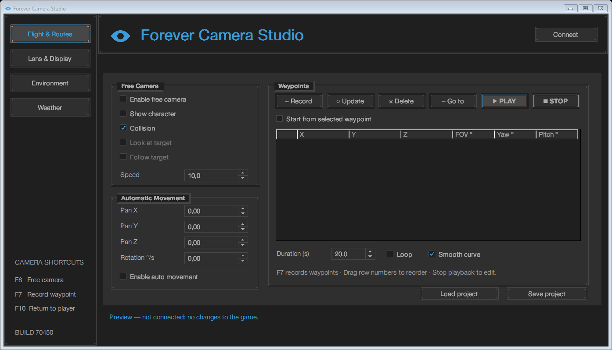
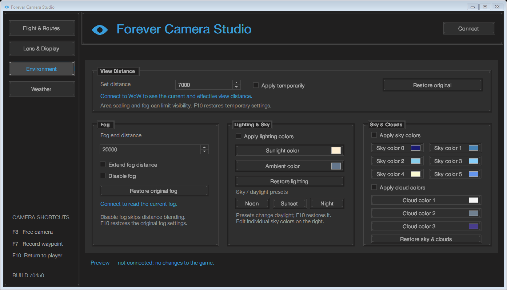

# Forever Camera Studio

A Windows camera and environment tool for **World of Warcraft: Forever 1.60.1, build 70450**.

**Experimental and unofficial. This tool reads and writes the running game's memory. Its use is likely prohibited by Blizzard's terms and may lead to account suspension or permanent closure. It is not approved by Blizzard and is not ban-safe.** An MIT license for this project does not grant permission to modify or use Blizzard software. See [usage and legal information](docs/USAGE-AND-LEGAL.md).

## Download

[Download v0.1.0-beta.1 for Windows x64](https://github.com/Deluxolol/forever-camera-studio/releases/tag/v0.1.0-beta.1)

Choose `ForeverCameraStudio-v0.1.0-beta.1-win-x64.zip`, extract it and run `ForeverCameraStudio.exe`. The standalone `.exe` is also provided. SHA-256 checksums are attached to the release. The executable is unsigned.

Requirements: Windows x64, .NET Framework 4.8 and exactly one compatible WoW client with a character in the world. Other client builds are rejected. No game client, game DLLs or proprietary fonts are included.

## Features

- Free camera with adjustable speed and field of view.
- **Show character** mode: detach the camera while retaining the player model.
- Record, edit, reorder, import and export camera waypoints.
- Smooth curve or straight route playback, looping and start from selected waypoint.
- Automatic camera movement and rotation.
- Temporary view distance, fog, rendering and world-time controls.
- Sunlight, ambient light, sky and cloud color controls.
- Rain, snow, thunder and lightning controls.
- Restore temporary changes using F10 or by closing the application normally.



## Controls

| Key | Action |
| --- | --- |
| F8 | Toggle free camera |
| F7 | Record a waypoint |
| F10 | Stop movement and restore temporary settings |

In **Show character** mode, use WASD or the arrow keys to fly. E/Space moves up; Q/X moves down. Hold the right mouse button to look around. Shift increases speed; Ctrl decreases it. Manual movement stops route playback. These controls are captured only while the game is in front and this mode is active.

Before enabling Show character, zoom out until the character is fully visible. Collision is unavailable in this mode; the original spectator camera remains available with Show character unchecked. Save routes with **Save project** before closing the application.

## Limitations

- Only client build 70450 is supported. Client updates require fresh validation.
- Slow motion, Look at target, Follow target and camera attachment controls are unavailable.
- Fog suppression may not eliminate all haze, ghost effects or skybox artwork.
- Weather is intended for outdoor scenes; other artwork can obscure it. Changing maps releases the weather override.
- Camera ownership changes, cinematics or changing character can stop the camera. F10 is the normal restore control. Abrupt termination cannot run cleanup; restarting the game may be necessary.
- Routes are limited to 128 points. Imported projects do not automatically start playback or enable environment overrides.
- Helvetica Neue is used only if compatible Roman/Bold faces are already installed locally; otherwise the interface uses Segoe UI. Font files are not distributed.



## Build from source

Install a recent Visual Studio 2022 with the .NET desktop development workload, the .NET Framework 4.8 targeting pack and a Roslyn compiler supporting C# 12. From Developer PowerShell:

```powershell
./src/Build.ps1 -CompilerPath (Get-Command csc.exe).Source
```

If `csc.exe` is not on PATH, pass the full path to Visual Studio's `MSBuild/Current/Bin/Roslyn/csc.exe`. The output is `src/build/ForeverCameraStudio.exe`. Icon assets are checked in; regenerate them only when changing the logo:

```powershell
./src/Build-AppIcon.ps1
```

## Validation

Offline UI checks can be run using Windows PowerShell 5.1 after building:

```powershell
powershell.exe -NoProfile -File ./src/Test-Window.ps1
powershell.exe -NoProfile -File ./src/Test-Inputs.ps1
powershell.exe -NoProfile -File ./src/Test-SelectedWaypoint.ps1
```

Other `Test-*.ps1` scripts include live integration checks that can change camera and environment state. Run those only with an appropriate compatible client and after saving your work; they are not part of the automatic build. Existing live validation does not guarantee compatibility with every scene or freedom from crashes.

## License and attribution

Project source and original logo: [MIT](LICENSE). See [NOTICE](NOTICE) for third-party names, fonts and permissions. This is an independent project and is not affiliated with Blizzard Entertainment or the creators of Free Far Sight or Machinae.
